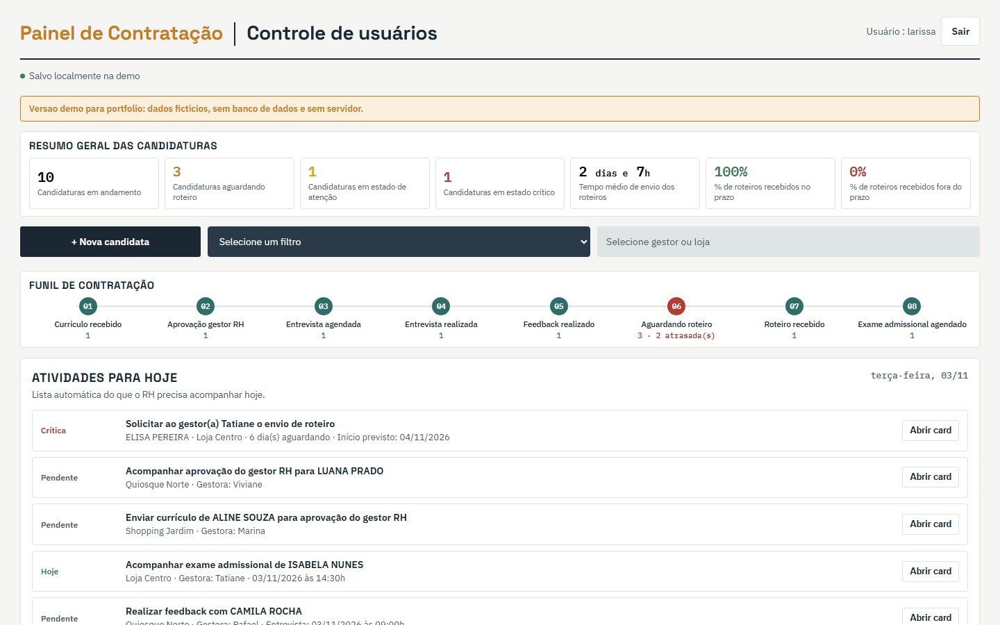

# Painel de Contratação

Funil de contratação do RH em 9 etapas, do currículo recebido à contratação concluída, com foco na etapa que mais trava: a espera pelo roteiro da gestora.

**[Ler o estudo de caso](https://lariantunez.github.io/painel-de-contratacao/)** · **[Abrir a demo do painel](https://lariantunez.github.io/painel-de-contratacao/painel/)**



> **Versão de portfólio.** O painel original roda em produção na empresa. Esta versão usa o mesmo desenho de telas e as mesmas regras, com dados fictícios, sem servidor e sem login real.

## O problema

Depois que a candidata é aprovada, o processo sai das mãos do RH: a gestora da loja precisa enviar o roteiro (o local de trabalho da nova contratada). Enquanto ele não chega, nada anda, e a data de início se aproxima. Ninguém sabia, de forma rápida, quem estava parado, havia quantos dias, com qual gestora e quem já tinha sido cobrado.

## O que eu construí

- **Quadro kanban de 9 etapas** com arrastar e soltar, incluindo a aprovação do gestor RH antes da entrevista. Cada etapa exige o dado que a define: entrevista pede data e hora, "aguardando roteiro" pede a data prevista de início.
- **Semáforo do roteiro** com 4 faixas (no prazo, atenção, atrasada, crítica). A regra crítica vem primeiro: início em 2 dias ou menos já é crítico, mesmo que a espera tenha sido curta.
- **7 indicadores clicáveis.** Cada um abre as candidatas por trás do número e mostra a conta por extenso.
- **Ranking por gestor** com pontuação que premia o prazo e pesa os atrasos, além de outras 5 ordenações.
- **Cobrança guiada por e-mail**, individual, por gestora ou em lote, com registro de quem cobrou e quando.
- **Histórico confiável:** encerrar exige motivo, voltar de etapa recorta o histórico e qualquer processo pode ser reaberto.

## Decisões técnicas

- A etapa gargalo é tratada como caso especial no código: cor própria, ordenação por urgência, filtros e indicadores dedicados.
- Cada candidatura é um registro único com duas listas que só crescem (`historico[]` e `cobrancas[]`). Todos os indicadores são calculados a partir delas, nunca guardados prontos.
- Nomes antigos de etapas são normalizados por uma tabela de equivalência, para que registros antigos e novos entrem nas mesmas contas.
- Incluir uma etapa no meio do funil com o painel em uso exigiu migrar os registros (a etapa é gravada como número) uma única vez e bloquear, no servidor, salvamentos vindos de abas com a versão anterior.

## Stack

HTML, CSS e JavaScript puro, sem framework. No projeto original, há login, perfis de usuário e bloqueio de edição simultânea do mesmo cartão.

## Estrutura

| Caminho | Conteúdo |
|---|---|
| `index.html` e `assets/` | Estudo de caso em 9 capítulos |
| `painel/index.html` | O painel completo, com dados fictícios, rodando no navegador |

## Rodar localmente

```bash
npx serve .
```

---

**🇺🇸 English:** a 9-stage hiring funnel for HR, from résumé to hire. It focuses on the stage that stalls the most (waiting for the store manager's assignment), with a 4-level deadline alert, 7 clickable KPIs that show their own math, a ranking by manager and guided e-mail follow-ups that are logged. Built in plain HTML, CSS and JavaScript. Portfolio version with fictional data; the original runs in production.
